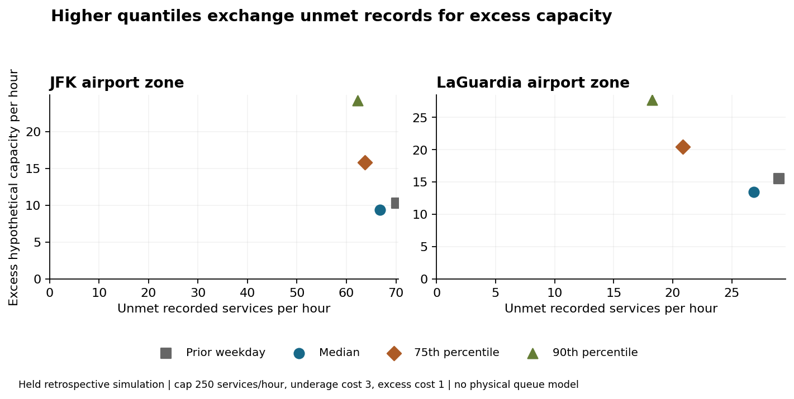

# Airport pickup-count policies: cost assumptions and stress cases

**Decision:** evaluate conditional capacity policies before seeking dispatch telemetry and fleet evidence. Public historical TLC records do not establish real-time input availability, latent passenger demand or rider/driver wait times.

**Verified finite comparison:** the frozen 75th-percentile policy has 4.5% lower modeled held cost than the median under cap 250 services per zone-hour and underage/excess costs 3:1. Total cost is 633,760 versus 663,611 hypothetical units over 4,368 held zone-hours. It reduces unmet recorded services from 204,548 to 184,856, while excess capacity rises from 49,967 to 79,192. Its raw-count MAE is 48.727 versus 42.022 for the median, so lower error and lower scenario cost select different policies.

**Failure retained:** on the fixed Thanksgiving/Christmas stress dates (96 zone-hours), the 75th policy costs 8,153 versus 7,086 for the median, 15.1% higher. At equal underage/excess costs it also costs more across all three declared capacity caps. No new policy was selected from these held outcomes.

**Practical next step:** obtain timestamped dispatcher telemetry, vehicle service cycles, actual spare supply, costs and queue/wait outcomes. Test a prospective, availability-correct policy before deployment. Current results are an idealized retrospective simulation, not operational readiness or savings.

## All primary airport and pooled cases

MAE is uncapped absolute record-count error per zone-hour. Unmet/excess are hypothetical service/capacity totals; cost/hour uses declared 3:1 units, not currency. Each airport has 2,184 held target hours; pooled has 4,368. Counts are exact; rates are rounded only for display.

| Scope | Policy | Raw MAE | Unmet | Excess | Cost/hour |
|---|---|---:|---:|---:|---:|
| JFK | Prior weekday | 51.609 | 153,222 | 22,392 | 220.723 |
| JFK | Median | 44.854 | 145,923 | 20,530 | 209.844 |
| JFK | 75th percentile | 55.088 | 139,265 | 34,564 | 207.124 |
| JFK | 90th percentile | 73.422 | 136,005 | 52,887 | 211.036 |
| LGA | Prior weekday | 46.962 | 63,353 | 33,895 | 102.543 |
| LGA | Median | 39.190 | 58,625 | 29,437 | 94.007 |
| LGA | 75th percentile | 42.366 | 45,591 | 44,628 | 83.059 |
| LGA | 90th percentile | 53.683 | 39,863 | 60,569 | 82.490 |
| Pooled | Prior weekday | 49.285 | 216,575 | 56,287 | 161.633 |
| Pooled | Median | 42.022 | 204,548 | 49,967 | 151.926 |
| Pooled | 75th percentile | 48.727 | 184,856 | 79,192 | 145.092 |
| Pooled | 90th percentile | 63.552 | 175,868 | 113,456 | 146.763 |

## Scope and evidence

The source projection reconciles 3,285,485 published airport-zone records using independent hourly/daily/monthly queries with unchanged metadata. All 17,568 nominal civil grid cells are retained; 578 absent groups mean zero published records. The two fixed DST transition dates contain 20,054 records and remain flagged, excluded from histories and targets. This does not verify true demand or reporting completeness.

January-June supplies initial history. All 18 calendar/window/quantile configurations and the prior-available-weekday baseline are evaluated on July-September. The declared rule independently selects 84-day weekday/hour histories for each quantile; the primary winner is the 75th percentile. Twenty-one canonical dependencies and selection bytes were publicly frozen before October-December policy summaries. Prior held counts may enter later histories only under the stated idealized immediate-availability assumption. Actual historical public vintages remain unverified.

Twelve fixtures, 83,904 validation and 17,472 held predictions, 2,592 scenario metric rows and 956,489 independent integer/rational/history/RMSE checks pass. The isolated replay matches 1,177,457 CSV fields and selection documents. The complete nine cap/cost settings, all airport/month groups, both named stress dates and finite leave-one-month sensitivity remain in results/. Those sensitivities are not confidence intervals or evidence of future coverage. No regression model, queue experiment, live dispatch, causal benefit or novelty claim is made.

The initial all-city diagnostic requested exact timestamp extrema. That response remains private; corrected public diagnostics use day-only bounds, with identical counts/version. No individual trip rows, IDs, fares, dropoffs or passenger fields were downloaded. Read SOURCE_CORRECTION.md, PROTOCOL.md, SOURCES.md, FREEZE.json and the independent manuscript. Formal-publication projects remain private.
